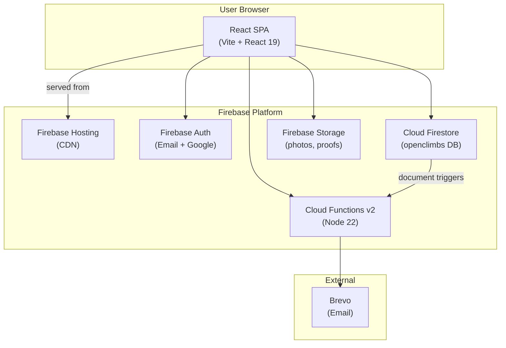
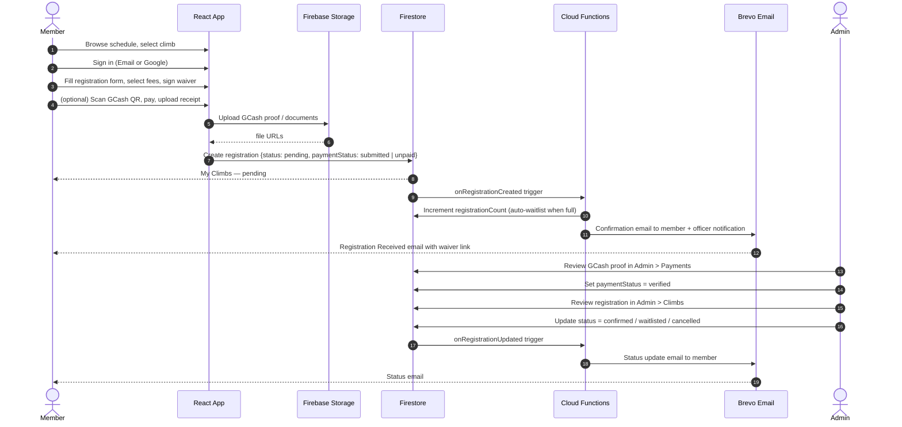

# MMS Open Climbs

Event management portal for the Metropolitan Mountaineering Society (MMS), reused each season with a new set of climbs. Members browse the schedule, view mountain profiles, register (or join a waitlist), sign digital waivers, submit GCash payments and required documents, and track their climbs. Administrators manage climbs, review registrations, verify payments, track climb money and service headcounts, and manage user accounts.

---

## System Overview



| Layer               | Technology                        |
| ------------------- | --------------------------------- |
| Frontend            | React 19, Vite 8, React Router 7  |
| Hosting             | Firebase Hosting                  |
| Database            | Cloud Firestore (`openclimbs` DB) |
| Authentication      | Firebase Auth (Email + Google)    |
| Storage             | Firebase Storage                  |
| Backend Functions   | Cloud Functions v2 (Node 22)      |
| Transactional Email | Brevo SMTP API                    |
| Testing (Frontend)  | Vitest, Testing Library           |
| Testing (Functions) | Jest                              |

---

## Features

### Member features

- Browse the climb schedule season by season, as a card grid with elevation, difficulty, and trip distance at a glance
- View full mountain profiles: summit elevation, difficulty, jump-off point, elevation gain, distances, features, itinerary, water source notes, and external links (AllTrails, Google Maps)
- Trail photo carousel on event and registration pages — click any photo to open a full-screen lightbox with keyboard navigation
- Register for a climb with personal details, emergency contact, experience level, and medical disclosure — or join the waitlist of a full climb
- Select optional fees (e.g., transport) and review the full fee breakdown before submitting
- Sign the digital liability waiver by typing your full name
- Pay via GCash now or later, in one go or in instalments — scan the QR code, pay, and upload the receipt
- Upload the documents a climb requires (medical certificate, permit, …) at registration or later
- Pledge to a climb's donation drive
- Track every registration on My Climbs with its status, balance, payment log and next steps; cancel your own
- Print your signed waiver
- Rate a climb afterwards
- See a one-time "what's new" popup after login for the latest release note, and browse the full history at any time on the Release Notes page
- In-app notification bell for status updates and announcements
- Guided welcome tour on first login walking through key member features
- Automatic thank-you email once a climb you joined has concluded

### Admin features

- Dashboard — overview of all climbs with type, slots, confirmed and pending counts
- Climbs management — create, edit, open/close, cancel or postpone; fees, GCash QR, officers, required documents, meetings, announcements, donation drives
- Climb detail — per-climb registrants with status and per-payment controls, split payments, refunds, walk-ins, no-shows, shared services, expenses and net funds, printable climb-day sheet
- All registrations — cross-climb view with search, status, payment, balance-due and missing-document filters, and CSV export
- Payment management — per-climb cash flow, optional-service headcounts, fees and GCash QR
- User management — create accounts, correct or delete accounts, assign admin roles, link walk-in "Add Joiner" entries to an existing member
- Analytics — page view traffic and the `failedRequests` error log
- App Insights — registration, payment, compliance, email, storage, function-health and cost dashboards
- Release notes — publish "what's new" updates, draft them from recent commits, and email every member as a tracked, resumable send (owner-granted permission)

---

## End-to-End Registration Flow



---

## Repository Structure

```text
src/
  pages/            route screens; page-only parts in pages/event, pages/register, pages/admin/climbForm
  components/       shared UI (Modal, TextField, AuthLayout, …)
  contexts/ hooks/  auth state and reusable hooks
  services/         the only code that talks to Firebase (ADR 0004)
  utils/            pure domain logic (fees, payments, schedules)
  data/ styles/     static content, design tokens
public/             static files served as-is at / (icons, manifest, logo)
functions/          Cloud Functions: src/{triggers,scheduled,callables,email,shared}, tests/, scripts/
firebase/           Firestore/Storage rules and indexes, CORS, storage lifecycle
tests/              unit, component, accessibility, integration, e2e, performance
scripts/            CLI helpers that use the web API key from .env
tools/              configs for dependency-cruiser, jscpd, secretlint, semantic-release; the CSS-collision
                    check and the inline-style ratchet list (knip's config lives in package.json)
docs/               guides/ (what it is) · solution-plans/ (how we deliver) · adr/ (why)
```

The root keeps only what a tool must find there: `package.json`, the Vite,
ESLint, editor and Firebase configs, `index.html` (Vite's entry), `CONTEXT.md`
(read by the domain-modeling skill) and `skills-lock.json`.

---

## Quickstart

```bash
npm install && npm --prefix functions install
cp .env.example .env            # fill in VITE_FIREBASE_*
npm run dev                     # http://localhost:5173
npm run qa                      # every quality gate, as CI runs it
```

Emulators, admin setup and the workflow: [CONTRIBUTING.md](docs/guides/CONTRIBUTING.md).
Deploys happen from CI on push to `develop`: [DEPLOYMENT.md](docs/guides/DEPLOYMENT.md).

---

## Documentation

| Question | Read |
|---|---|
| How is it built? | [ARCHITECTURE](docs/guides/ARCHITECTURE.md) · [DATA](docs/guides/DATA.md) · [API](docs/guides/API.md) · [SECURITY](docs/guides/SECURITY.md) |
| How do I work on it? | [CONTRIBUTING](docs/guides/CONTRIBUTING.md) · [TESTING](docs/guides/TESTING.md) · [CODE-QUALITY](docs/guides/CODE-QUALITY.md) · [TROUBLESHOOTING](docs/guides/TROUBLESHOOTING.md) |
| How do I use it? | [USER_MANUAL](docs/guides/USER_MANUAL.md) |
| How do we deliver it? | [docs/solution-plans/](docs/solution-plans/) — web plan, release notes, quality harness |
| Why is it like this? | [docs/adr/](docs/adr/README.md) |
| What do the words mean? | [CONTEXT.md](CONTEXT.md) — domain glossary |
