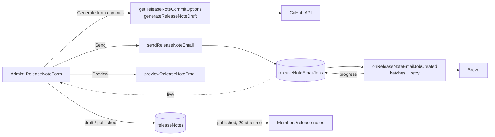

# Release notes — delivery plan

Admins publish "what's new" notes; members read them at `/release-notes` and
can be emailed when one is published. Built on the existing Firestore +
Functions + Brevo pipeline. Why the send works this way:
[ADR 0005](../adr/0005-release-note-email-jobs.md).

## What it does

- Drafts are admin-only; published notes are visible to every signed-in
  user, newest first, with "Show older updates" paging.
- Admins can edit, unpublish or delete a note (delete asks first).
- The commit-based draft groups conventional commits and drops
  `docs`/`test`/`chore`/`ci` noise; `npm run release-notes` does the same in a
  terminal.
- Emailing everyone: preview → confirm → queued job with a progress bar.
  Needs the `canEmailMembers` permission, granted by the project owner and
  dropped automatically when the account stops being an admin.
- A send that stops partway shows as stalled on the card; sending again
  carries on with the members left (the preview and confirm button say how
  many), and the note's sent count covers the whole send.

Code: `src/pages/ReleaseNotes.jsx`, `src/pages/admin/ReleaseNote*.jsx` +
`src/pages/admin/releaseNoteForm/`, `src/services/releaseNotes.js`,
`functions/src/callables/releaseNotes.js`,
`functions/src/triggers/releaseNoteEmailJobs.js`,
`functions/src/shared/batchSend.js`.

## After deploy

The project owner grants senders from a terminal with Google Cloud access:
`node functions/scripts/grant-email-members.mjs <uid|email>` (`--revoke` to
undo). The Users page shows who has it and the exact command.

## Open

| Risk | Status |
|---|---|
| More than a few thousand recipients exceeds one job's 9 minutes | The job stalls; the card says so, and Send (enabled again after 15 min) resumes after the last finished batch — that batch's members may get it twice. Automatic continuation not built |
| `emailSentCount` counts Brevo acceptances, not deliveries | Accepted |
